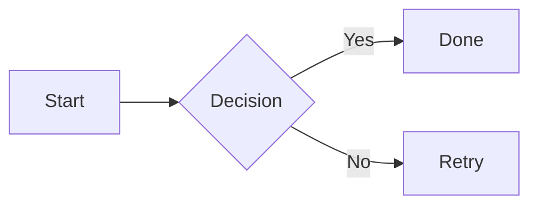
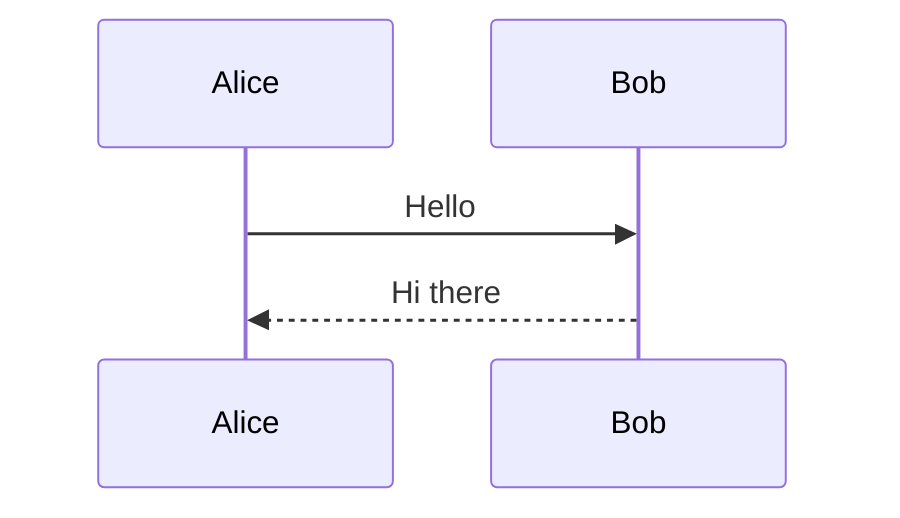
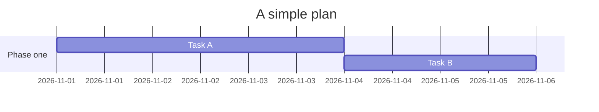
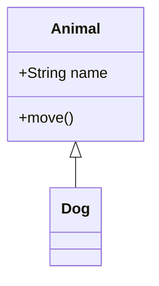
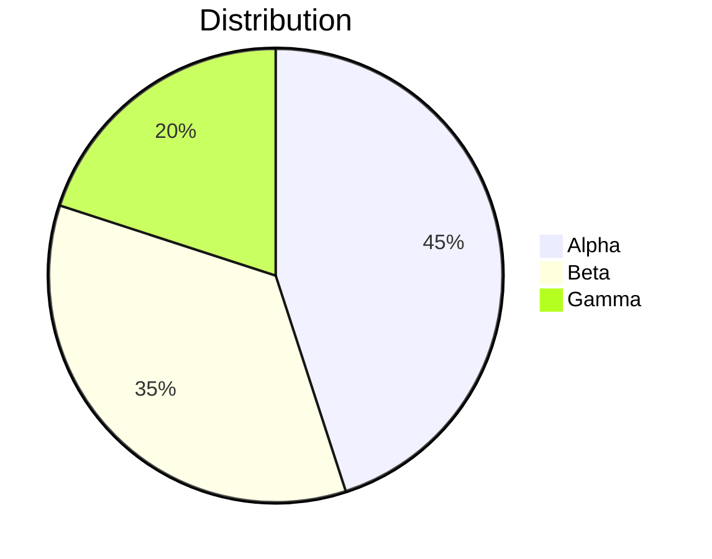

# GitHub 非 GFM 扩展

本文件测试 GitHub 支持、但不在 GFM 规范内的语法。
这些语法由 GitHub 平台额外渲染，编辑器可能不支持；不支持的编辑器通常降级为原文。
GFM 规范内的扩展见 `gfm-ext.md`，与 CommonMark 的差异见 `gfm-edge.md`。

示例文字一律用英文，说明文字用中文。

## 数学公式

数学公式用美元符号界定：行内用单个美元符包裹，行间用双美元符独占一行。GitHub 用数学排版引擎渲染，不支持的编辑器会原样显示美元符。

T:行内公式 | 源 GitHub Docs（数学）  
预期 渲染为行内数学排版，或原样显示 | 流行度 A

The mass-energy relation is $E = mc^2$ written inline.

T:行间公式 | 源 GitHub Docs（数学）  
预期 公式独占一行并居中排版 | 流行度 A

The display formula follows:

$$\int_0^1 x^2 \, dx = \frac{1}{3}$$

## 脚注

脚注由正文中的方括号引用与文末的定义组成：`[^标签]` 指向 `[^标签]: 内容`。GitHub 把它渲染为带编号的脚注；行内脚注则把内容直接写在引用处。

T:引用式脚注 | 源 GitHub Docs（脚注）  
预期 正文出现脚注编号，文末出现脚注内容 | 流行度 A

Here is a footnote reference[^note-a] pointing to the definition below.

[^note-a]: This is the footnote content, usually shown at the bottom of the page.

T:行内脚注 | 源 GitHub Docs（脚注）  
预期 脚注内容直接写在引用处 | 流行度 B

This is an inline footnote^[The content is embedded directly at the reference position.] form.

## Emoji

GitHub 会把冒号包裹的短代码渲染为对应表情；不认识的短代码按原文显示。具体图形由字体决定。

T:冒号包裹的短代码 | 源 GitHub Docs（emoji）  
预期 渲染为对应表情，或原样显示 | 流行度 B

This paragraph has the short codes :smile: and :rocket: in it.

## Alerts

Alerts 是引用块的扩展：引用首行写类型标记，五种类型为 NOTE、TIP、IMPORTANT、WARNING、CAUTION。类型大小写敏感，无效类型退化为普通引用，标记必须位于引用首行。

T:NOTE | 源 GitHub Docs（Alerts）  
预期 带信息图标的提示框 | 流行度 A

> [!NOTE]
> Useful information that users should know.

T:TIP | 源 GitHub Docs（Alerts）  
预期 带建议图标的提示框 | 流行度 A

> [!TIP]
> A helpful piece of advice.

T:IMPORTANT | 源 GitHub Docs（Alerts）  
预期 带重要标记的提示框 | 流行度 B

> [!IMPORTANT]
> Information the user must not miss.

T:WARNING | 源 GitHub Docs（Alerts）  
预期 带警告图标的提示框 | 流行度 B

> [!WARNING]
> Something that needs immediate attention.

T:CAUTION | 源 GitHub Docs（Alerts）  
预期 带危险图标的提示框 | 流行度 B

> [!CAUTION]
> A negative consequence is possible.

T:小写与无效类型 | 源 GitHub Docs（Alerts 大小写敏感）  
预期 小写可能不生效，无效类型退化为普通引用 | 流行度 C

> [!note]
> Lowercase may not render as an alert.

> [!UNKNOWN]
> An unknown type becomes a plain block quote.

T:内含行内语法 | 源 结构组合  
预期 粗体与行内代码在提示框内生效 | 流行度 B

> [!TIP]
> Run `git status` to see **modified files**.

T:标记不在引用首行 | 源 位置条件  
预期 不识别为 alert，按普通引用显示 | 流行度 C

> Some text appears before the marker.
> [!NOTE]
> This does not start with the marker.

## Mermaid 图表

Mermaid 以带语言标识符的围栏书写，因此被测对象就是围栏本身：判断编辑器把带 mermaid 标识的围栏渲染为图表，还是当作普通代码或纯文本。

T:流程图 | 源 Mermaid flowchart  
预期 渲染为流程图 | 流行度 A



T:时序图 | 源 Mermaid sequenceDiagram  
预期 渲染为时序图 | 流行度 A



T:甘特图 | 源 Mermaid gantt  
预期 渲染为甘特图 | 流行度 B



T:类图 | 源 Mermaid classDiagram  
预期 渲染为类图 | 流行度 B



T:饼图 | 源 Mermaid pie  
预期 渲染为饼图 | 流行度 B



T:非法语法 | 源 Mermaid 语法错误  
预期 显示错误提示或降级为代码，不应崩溃 | 流行度 C

```mermaid
this is not a valid mermaid diagram
```

T:引用块内的围栏 | 源 结构组合  
预期 引用块内渲染图表，或整体降级 | 流行度 C

> ```mermaid
> flowchart LR
>   A --> B
> ```

## 折叠详情

GitHub 支持用原始 HTML 的折叠标签构造可展开区块。它是 HTML 直通能力在 GitHub 上的常见用法，不属于 GFM 规范语法。

T:折叠区块 | 源 GitHub Docs（HTML）  
预期 渲染为可折叠区块，默认收起 | 流行度 B

<details>
<summary>A summary line</summary>

Hidden content appears when expanded.

</details>

## 颜色模型

GitHub 会把十六进制、`rgb()`、`hsl()` 形式的颜色代码渲染为色块。这是平台层渲染，不属于 GFM 规范。

T:十六进制颜色 | 源 GitHub Docs（颜色）  
预期 渲染为对应颜色的色块，或原样显示 | 流行度 C

The background color is #0969da in this sentence.

T:RGB 与 HSL | 源 GitHub Docs（颜色）  
预期 渲染为色块，或原样显示 | 流行度 D

The colors rgb(9, 105, 218) and hsl(212, 92%, 45%) appear here.

## 未闭合

以下故意保持未闭合，用于观察是否吞掉后续内容；置于文件末尾，其后不得有任何内容。

T:未闭合围栏吞掉余下内容 | 源 围栏未闭合  
预期 本行之后到文件末尾全部成为代码 | 流行度 B

```mermaid
flowchart LR
  A --> B
