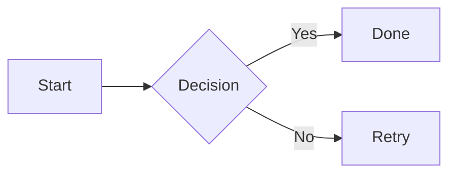
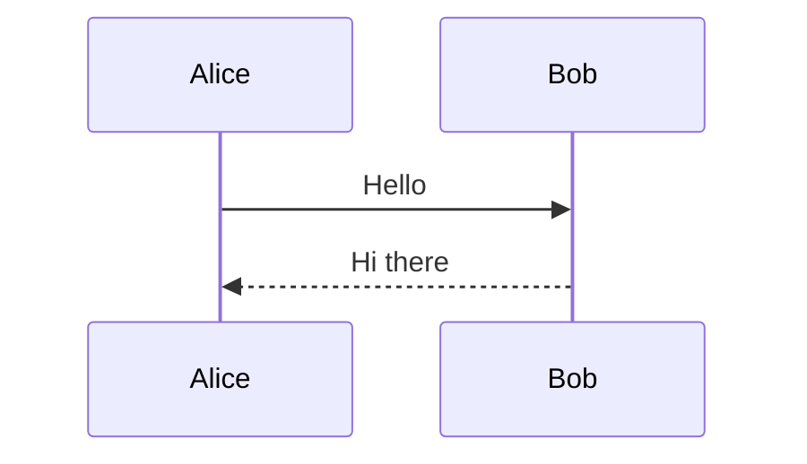
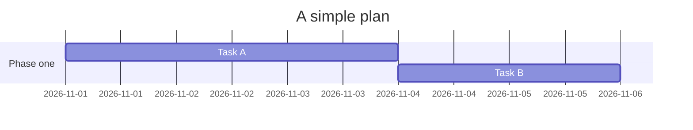
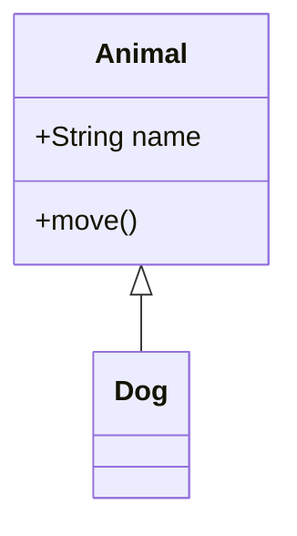
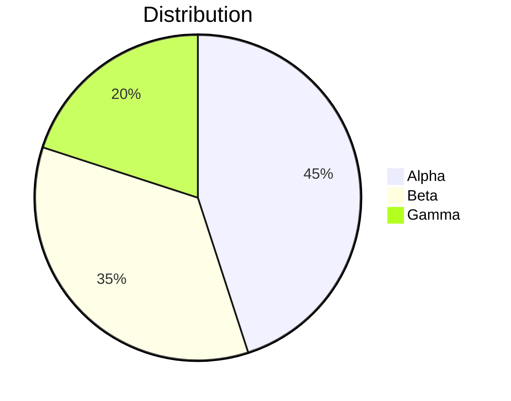

# Mermaid 图表

本文件测试编辑器对 Mermaid 图表的渲染。
Mermaid 以带语言标识符的围栏书写，因此这里被测的对象就是围栏本身——判断编辑器把带 mermaid 标识的围栏渲染为图表，还是当作普通代码或纯文本。
示例文字一律用英文，说明文字用中文。

## 常见图型

T:流程图 | 源 Mermaid flowchart  
预期 渲染为流程图 | 流行度 A



T:时序图 | 源 Mermaid sequenceDiagram  
预期 渲染为时序图 | 流行度 A



T:甘特图 | 源 Mermaid gantt  
预期 渲染为甘特图 | 流行度 B



T:类图 | 源 Mermaid classDiagram  
预期 渲染为类图 | 流行度 B



T:饼图 | 源 Mermaid pie  
预期 渲染为饼图 | 流行度 B



## 边界

T:非法语法 | 源 Mermaid 语法错误  
预期 显示错误提示或降级为代码，不应崩溃 | 流行度 C

```mermaid
this is not a valid mermaid diagram
```

T:引用块内的围栏 | 源 结构组合  
预期 引用块内渲染图表，或整体降级 | 流行度 C

> ```mermaid
> flowchart LR
>   A --> B
> ```

T:未闭合围栏吞掉余下内容 | 源 围栏未闭合  
预期 本行之后到文件末尾全部成为代码 | 流行度 B

```mermaid
flowchart LR
  A --> B
